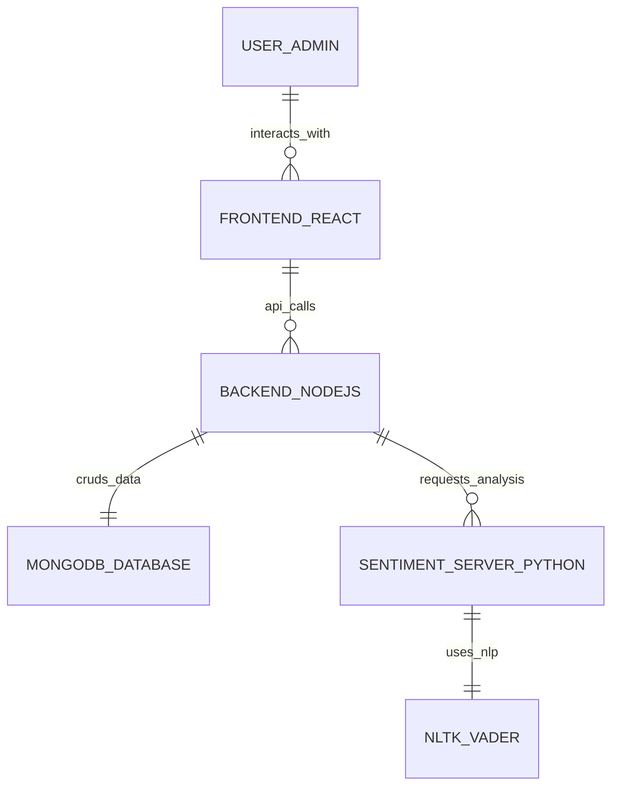

# 🛒 Dark Store E-Commerce Website using Sentiment Analysis Prediction

## 📌 Project Overview
**Dark Store** is a cutting-edge E-Commerce platform that goes beyond traditional shopping. It integrates **Sentiment Analysis** to dynamically rank products based on real-time user feedback. By analyzing the emotional tone of customer reviews, the platform ensures that products with genuine positive acclaim are featured more prominently, providing a curated and trust-driven shopping experience.

---

## 🌐 Live Demo

<div align="left">
  <a href="https://storedark.netlify.app/" target="_blank" rel="noopener noreferrer">
    
  </a>
  &nbsp;&nbsp;
  <a href="https://dashboard-darkstore.netlify.app/admin/dashboard" target="_blank" rel="noopener noreferrer">
    
  </a>
</div>

---

## 🏛️ System Architecture



## 🚀 Key Features

### 🛍️ For Customers
- **Intuitive Shopping**: Seamlessly browse and search products by categories and keywords.
- **Sentiment-Sorted Products**: Products are automatically ranked based on their "Real Sentiment Score," ensuring top-rated items are always visible.
- **Transparent Reviews**: Leave detailed reviews and ratings that contribute to the project's AI-driven ranking system.
- **Secure Payments**: Integrated with **Razorpay** for a smooth and safe checkout experience.
- **Order Tracking**: Keep track of your purchases and shipping status in real-time.

### 🛠️ For Admins
- **Comprehensive Dashboard**: Manage products, users, and orders from a powerful administrative interface.
- **Sentiment Analytics**: Visualize product performance and customer sentiment trends using interactive charts.
- **Dynamic Inventory Management**: Effortlessly add, update, or remove products with support for high-quality image uploads.
- **Order Processing**: Manage the entire lifecycle of an order, from placement to delivery.

---

## 🧠 The Intelligence: Sentiment-Driven Ranking
The core innovation of Dark Store lies in its integration with a dedicated **Sentiment Analysis Server**.

### How it Works:
1. **User Feedback**: A customer leaves a review on a product.
2. **Real-time Processing**: The Node.js backend sends the review text to the Python sentiment server.
3. **Sentiment Extraction**: Using **NLTK's VADER (Valence Aware Dictionary and sEntiment Reasoner)**, the server calculates the positive and negative scores of the comment.
4. **Dynamic Ranking**:
   - If Sentiment is **Positive** (`pos > neg`): Product ranking increases.
   - If Sentiment is **Negative** (`neg > pos`): Product ranking decreases.
5. **Smart Sorting**: The `getAllProducts` API automatically sorts the catalog by these ranking scores, meaning the "voice of the customer" directly influences product visibility.

---

## 📂 Module Deep Dive

### 🏠 1. <a href="https://storedark.netlify.app/" target="_blank" rel="noopener noreferrer">Client (Customer Storefront)</a>
The user-facing application where customers can browse and purchase products.
- **Dynamic Catalog**: Real-time product fetching with category and keyword search.
- **Sentiment-Aware UI**: Products are displayed based on their ranking calculated from user reviews.
- **Seamless Checkout**: Integration with Razorpay for secure transaction processing.
- **User Dashboard**: Personal profile management and order history tracking.
- **Interactive Reviews**: Real-time feedback submission that influences product visibility.

### 📊 2. <a href="https://dashboard-darkstore.netlify.app/admin/dashboard" target="_blank" rel="noopener noreferrer">Dashboard (Admin Management)</a>
A powerful administrative tool for managing the entire e-commerce ecosystem.
- **Analytical Overview**: Visualize site performance, total sales, and user growth.
- **Inventory Control**: Full CRUD (Create, Read, Update, Delete) operations for products.
- **Order Lifecycle**: Review and update the status of customer orders.
- **Sentiment Insights**: View sentiment analysis distribution for each product to understand customer satisfaction.
- **Rich Content Editing**: Integrated rich-text editor for detailed product descriptions.

### ⚙️ 3. Backend (Main API Server)
The central nervous system of the project, built with Node.js and Express.
- **RESTful API**: Secure and scalable endpoints for frontend consumption.
- **Robust Security**: JWT-based authentication and Bcrypt password hashing.
- **Database Orchestration**: Efficient data modeling and management using Mongoose and MongoDB.
- **Payment Bridge**: Server-side validation and processing for Razorpay payments.
- **Automated Emails**: Integrated Nodemailer for order confirmations and user notifications.
- **File Management**: Handling high-quality product image uploads via Multer.

### 🤖 4. Sentiment Server (AI Engine)
A dedicated Python service focused on natural language processing.
- **NLP Processing**: Uses NLTK's VADER to perform valence-aware sentiment analysis.
- **Polarity Scoring**: Quantifies review emotional tone into positive, negative, and neutral metrics.
- **Lightweight API**: Fast, specialized Flask endpoints designed specifically for sentiment extraction.
- **Dynamic Ranking Feedback**: Directly informs the backend ranking logic to adjust product visibility.

---

## 💻 Tech Stack

### Frontend (Client & Dashboard)
- **Framework**: React.js
- **Styling**: Tailwind CSS (Glassmorphic Design)
- **State Management**: React Hooks & Context API
- **Visuals**: Chart.js for analytics, React-Toastify for notifications
- **Rich Text**: React Quill for product descriptions

### Backend (API Server)
- **Environment**: Node.js, Express.js
- **Database**: MongoDB (Mongoose ODM)
- **Authentication**: JSON Web Tokens (JWT) & BcryptJS
- **Payments**: Razorpay API
- **File Handling**: Multer for image storage
- **Communication**: Axios & Nodemailer

### AI/ML (Sentiment Server)
- **Language**: Python
- **Framework**: Flask
- **NLP Library**: NLTK (VADER Sentiment Analyzer)

---

## 🏗️ Project Structure
```text
dark-store-ecommerce/
├── backend/            # Express.js API Server
├── client/             # Customer-facing React App
├── dashboard/          # Admin/Seller React Dashboard
├── sentimentServer/    # Python Sentiment Analysis Service
└── README.md           # Project Documentation
```

---

## 🛠️ Setup & Installation

Follow these steps to set up the complete ecosystem on your local machine.

### 1. Environment Variable Configuration
Before starting the backend, you must configure its environment variables:
1. **Locate** the `.env.example` in the `backend/` directory.
2. **Copy** it to a new file named `.env`.
3. **Configure** each of the following variables:

| Variable | Definition |
| :--- | :--- |
| **PORT** | The port number on which the backend server will run (e.g., 8000). |
| **HOST** | The local or production host name (usually `localhost`). |
| **DB_URL** | Your MongoDB connection string (e.g., `mongodb://localhost:27017`). |
| **SENTIMENT_SERVER_URL** | The endpoint for the Python AI engine (e.g., `http://127.0.0.1:5000`). |
| **SECRET_KEY_OF_JWT** | Secret key for signing and verifying user authentication tokens. |
| **SECRET_KEY_OF_ADMIN_JWT** | Secret key specifically for signing admin authentication tokens. |
| **SMTP_HOST** | Your email service provider's SMTP host (e.g., `smtp.gmail.com`). |
| **SMTP_PORT** | Your email service port (e.g., `465` for SSL or `587` for TSL). |
| **SMTP_SENDER_EMAIL** | The email address used for sending automated notifications. |
| **SMTP_SENDER_PASSWORD** | The app-specific password for the email account used. |
| **RAZORPAY_KEY_ID** | Your public Razorpay API key for triggering checkouts. |
| **RAZORPAY_KEY_SECRET** | Your private Razorpay secret for safe payment verification. |

### 2. Backend Setup
1. Navigate to the `backend/` directory.
2. Install dependencies: `npm install`
3. Configure your `.env` (Backend defaults to **Port 4000** or **8000** depending on your `.env` configuration).
4. Start the server: `npm run dev`

### 3. Client & Dashboard (Frontend) Setup
1. Navigate to the `client/` or `dashboard/` directory.
2. Install dependencies: `npm install`
3. **Note**: These applications are pre-configured to communicate with the backend. Ensure the backend is running first.
4. Start the application: `npm start`
   - **Client** typically runs on: `http://localhost:3000`
   - **Dashboard** typically runs on: `http://localhost:3001` or `3000`

### 4. Sentiment Server Setup
1. Navigate to the `sentimentServer/` directory.
2. Create a virtual environment: `python -m venv venv`
3. Activate environment and install requirements: `pip install -r requirements.txt`
4. Run the Python setup script to download VADER data: `python vader_lexiconDownload.py`
5. Start the server: `python app.py`
6. **Note**: This server runs on **Port 5000** and must be active for the ranking system to function.

---

## 📝 License
This project is licensed under the **ISC License**.
